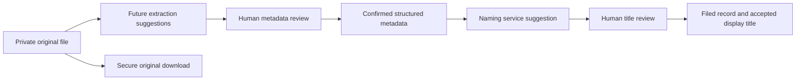

# Intelligent document naming — proposal only

No naming schema, title generation, OCR pipeline, company settings or Phase 4 implementation is included in the current task. This proposal needs approval before implementation.

## Source of truth and compatibility

Keep structured metadata authoritative and preserve the original filename, private storage path, checksum and original bytes. A display title is a separate human-readable value. Downloads keep the original filename unless a future, separately approved download option explicitly chooses another name.

Existing documents continue displaying their existing filenames until a user explicitly accepts a proposed title. No bulk backfill, file rename or automatic correction of existing titles is proposed. A title accepted at filing should be a stored snapshot so later template changes do not silently rename the archive.

## Proposed data model (future migrations)

| Addition | Purpose |
| --- | --- |
| `documents.display_title`, nullable string | Reviewed title; null preserves the current filename display behavior. |
| `documents.title_source`, nullable `generated` / `manual` | Preserve manual edits when metadata changes. |
| `documents.naming_template_version`, nullable string | Record which rules produced an accepted generated title. |
| `documents.router_range_start` / `router_range_end`, nullable strings | Preserve endpoints such as `001` and `053`, including leading zeroes. These are ranges, never dates. |
| Reference kind `order` | Model a customer order distinctly; a job number must not silently become an order number. Extend the existing enum, validation and Vue types only after approval. |
| Optional naming-reference selection | Resolve multiple references of a kind and the presently unspecified MTR/RMA numbering source. Prefer explicit primary-reference selection over the first database row. |
| Optional Waybill customer relationship | Current Waybills deliberately do not use vendor/customer selection. Add customer support through an approved metadata/policy/validation change; retain the existing `carrier` field as courier metadata. |

MTR and RMA examples contain an unspecified `12345`. Confirm whether each represents a PO, job, report/certificate number, RMA authorization number or another identifier. If report/RMA numbers are independent identifiers, add explicit reference kinds; do not mislabel them as a PO. Confirm whether router ranges always use three-digit endpoints and whether one document can contain multiple ranges before choosing validation constraints.

Router endpoints should be validated as digit strings and compared numerically for start <= end while stored as strings. Existing required filing fields remain unchanged until the business explicitly approves changes; naming preferences must not bypass current filing validation.

## Reusable naming service

Propose a pure server-side `DocumentNamingService::suggest(metadata, preferences)` returning:

- Suggested display title and template/version identifier.
- Missing values and fallback decisions.
- Ambiguities requiring review, including multiple eligible references or unconfirmed dates.

Use small category-specific formatters sharing helpers for confirmed dates, selected references, readable party/courier names and separator cleanup. Avoid a general expression/template engine. Format segments, omit unavailable optional segments, collapse duplicate separators, and escape titles in the UI. Preserve original reference formatting and leading zeroes in display values; normalized values remain for searching.

The service has no storage writes, database mutations or OCR calls. Tests can supply metadata directly and cover precedence, missing values, leading zeroes, ranges, accents, title length and ambiguous dates.

## Default templates

Display titles use spaces by default. Underscores may be selected later as a separator preference; they are never a requirement for recognizing uploaded documents.

| Category | Proposed default |
| --- | --- |
| Job Router | `Job Router {job} {router_start}-{router_end}` |
| Vendor Packing Slip | `Packing Slip PO {po} ({document_date})` |
| Customer Packing Slip | `Packing Slip Invoice {invoice} ({document_date})`; fall back to `Packing Slip Order {order} ({document_date})`. Invoice takes priority. |
| MTR | `MTR {selected_mtr_naming_reference} ({document_date})` |
| RMA | `RMA {selected_rma_naming_reference} ({document_date})` |
| Waybill | `{courier} {customer} {selected_reference} ({document_date})` |

The default date token uses the confirmed **document date**, formatted **DD-MM-YY**. Handled and upload dates remain separate and are not silent substitutes. If Allied Metal instead uses the handled date for a category, choose that explicitly in its approved template.

For missing optional dates, omit the entire parenthesized segment. If no usable naming reference exists, propose a category label plus an unambiguous document UUID suffix and show a review warning. Missing courier/customer segments are omitted with a warning. Multiple references should prompt selection or use an explicitly configured policy. Never invent numbers, dates or entities. The example courier/customer names are examples only, not configuration defaults.

## Review flow

Keep the existing single metadata form. In a future naming step, show a read-only suggested title near its filing actions, together with missing-value/ambiguity notes. Allow an explicit override and show whether it is generated or manual. Recompute the suggestion when relevant metadata changes, but never overwrite a user's manual draft.

At filing, validate metadata with the existing service, then store only an explicitly reviewed title and its template version in the same transaction. When correcting an already filed document, offer an explicit choice to update its display title; preserve the existing title by default. Saving a draft does not rename any physical file.

## Date interpretation

Store confirmed document/handled dates in their existing database DATE fields (ISO `YYYY-MM-DD` values). Presentation uses DD-MM-YY. Continue displaying upload timestamps independently with their time zone.

An extraction parser should strictly validate calendar dates and produce candidates for DD-MM-YY, DD/MM/YYYY, MM-DD-YY and MM/DD/YYYY. `11-10-26` yields both 11 October 2026 and 10 November 2026. Company format and surrounding text may rank a likely candidate, but cannot mark it confirmed. Require the user to choose the interpretation before applying it. If a two-digit year cannot be established from context, request its full year rather than silently choosing a century. Unambiguous dates may be suggested, but OCR-derived metadata is still reviewed before filing.

Maintain extracted raw text, source location, candidate interpretations and user-confirmation state separately from confirmed DATE values. Job-router ranges are excluded from date parsing through category context and explicit range fields.

## Company preferences without multi-tenancy

Start with a versioned, single-company PHP configuration containing category prefixes, allowed tokens, date format, separator, reference precedence and fallback policies. Use a narrow token whitelist and enumerated format choices, not arbitrary executable templates.

Later, an approved administrator UI can persist overrides in one validated company-preferences record and overlay them on defaults. Keep preference permissions admin-only and distinguish naming completeness from existing filing requirements. This does not require tenant IDs, a tenant router or a new application-wide Settings feature now. Template changes affect future suggestions, not accepted existing titles.

## Future OCR integration

After explicit Phase 4 approval, investigate extraction from existing PDF text first and OCR for image-only pages. Use an asynchronous, bounded job against authorized private originals, with page/size limits and explicit status/progress. Select engines after testing representative manufacturing scans, dates, multi-page files and accuracy; no engine or service is selected or installed in this task.

Propose a separate extraction record containing document ID, engine/version, status, suggested structured values, confidence, raw evidence/source page and date candidates. Extraction writes suggestions only; it never changes the canonical document type, confirmed metadata, title, filename or original bytes. Users apply/correct suggestions through the existing metadata validation service before filing. Treat extracted text as document content, never as operational instructions.

## Implementation phases requiring approval

1. Confirm numbering sources, Waybill reference priority, date source per category, range constraints and the fallback policy.
2. Approve the small metadata/title migrations; implement the pure naming service and focused unit tests. Do not backfill existing display titles.
3. Add suggestion/review/override behavior to the existing metadata form and preserve title snapshots on filing/correction.
4. Add single-company preferences only when needed and approved, using the validated configuration overlay.
5. Begin Phase 4 extraction/OCR only after its architecture is explicitly approved; keep its suggestions separate and reviewable.

Acceptance cases should include every provided naming example, invoice-over-order precedence, missing dates/references, repeated partial-delivery POs, router `001-053` preservation, both interpretations of `11-10-26`, original-file immutability and unchanged legacy display behavior.
